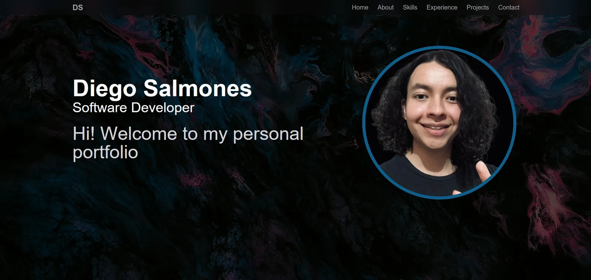

# 🚀 Diego's Portfolio

A responsive, modern personal portfolio showcasing my work experience, software development projects and technical skills. Available in English and Spanish, with a language toggle in the navbar.

🌐 **Live site:** [diegosalmones-portfolio.vercel.app](https://diegosalmones-portfolio.vercel.app/)



## 🧠 Sections

- 🏠 **Hero** — Personal introduction with animated text
- 👨‍💻 **About Me** — Grid with my background, education and resume download
- ⚙️ **Skills** — Animated marquees grouped by languages, frontend, backend, DevOps, AI tools and more
- 💼 **Work Experience** — Timeline of roles and responsibilities
- 🧩 **Projects** — Project cards with tech tags, live demo / repository links and an image gallery lightbox
- 📬 **Contact** — Form that sends messages directly via EmailJS

## 🛠️ Tech Stack

- ⚛️ [React 19](https://react.dev/)
- ⚡ [Vite 7](https://vite.dev/)
- 🎨 [Tailwind CSS v4](https://tailwindcss.com/) + [tailwind-merge](https://github.com/dcastil/tailwind-merge)
- 🎬 [Motion](https://motion.dev/) for animations
- 🌍 [i18next](https://www.i18next.com/) + [react-i18next](https://react.i18next.com/) for English/Spanish translations
- 📧 [EmailJS](https://www.emailjs.com/) for the contact form
- 🔣 [React Icons](https://react-icons.github.io/react-icons/)
- ▲ Deployed on [Vercel](https://vercel.com/)

## 🏁 Getting Started

Requires [Node.js](https://nodejs.org/) 20.19+ (needed by Vite 7).

```bash
git clone https://github.com/DiegoSalm522/DiegosPortfolio.git
cd DiegosPortfolio
npm install
npm run dev
```

The dev server runs at [http://localhost:8000](http://localhost:8000).

| Script            | Description                        |
| ----------------- | ---------------------------------- |
| `npm run dev`     | Start the Vite dev server          |
| `npm run build`   | Build for production into `dist/`  |
| `npm run preview` | Preview the production build       |
| `npm run lint`    | Run ESLint                         |

## 📁 Project Structure

```
design/              Full-size logo source files (not deployed)
public/assets/       Static assets (images, logos, icons, resume)
src/
├── sections/        Page sections (Navbar, Hero, About, Skills, Experience, Projects, Contact, Footer)
├── components/      Reusable and animated UI components
├── constants/       Portfolio data: projects, experience, skills and social links (images, URLs, tags)
├── locales/         Translations (en.json, es.json)
├── i18n.js          i18next setup
├── App.jsx          Assembles the sections
└── index.css        Tailwind theme tokens and shared styles
```

Most content updates only require editing the data files in `src/constants/` and the translations in `src/locales/`. The sections render whatever is there. All user-visible text lives in the locale files, so `en.json` and `es.json` must keep the same keys.

## 📄 License

This project is licensed under the [MIT License](LICENSE).

## 🤝 Let's Connect!

Feel free to explore the portfolio and reach out — I'm always open to new opportunities, collaborations and creative projects! 🌟
